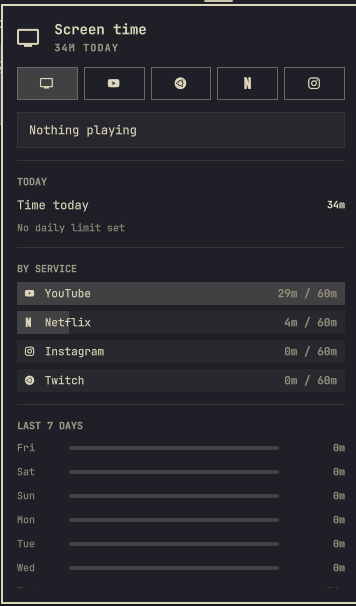

# Screen Time



Bar widget for the Omarchy shell that tracks how long you spend on YouTube,
Twitch, Netflix and Instagram each day. It shows today's total minutes in the
bar (with the glyph of whatever is being counted right now), a panel with a tab
per service plus "All", the last seven days, and notifications when you reach
a daily limit, per service or in total.

## Install

```bash
omarchy plugin add https://github.com/albertojnk/omarchy-screen-time.git --enable
```

The widget lands in the right section of the bar; move it with
`omarchy bar move io.github.albertojnk.screen-time --before omarchy.agents`.
Installing by hand also works: clone the repository into
`~/.config/omarchy/plugins/io.github.albertojnk.screen-time/`, run
`omarchy-shell shell rescanPlugins`, then
`omarchy plugin enable io.github.albertojnk.screen-time`.

## Remove

```bash
omarchy plugin remove io.github.albertojnk.screen-time
rm -rf ~/.local/state/omarchy/screen-time   # optional: delete the recorded history
```

## Requirements

Only what Omarchy already ships: the Omarchy shell (Quickshell) with its
`qs.Commons` and `qs.Ui` components, a Nerd Font for the service glyphs,
`omarchy-notification-send` for notifications, and `bash` for the one-time
state read. No sudo or pkexec is required, nothing is downloaded, and no
network access is made. The plugin writes only to
`~/.local/state/omarchy/screen-time/days.json`; its settings live in your
`~/.config/omarchy/shell.json` entry like any other bar widget.

## How time is counted

Every `pollIntervalSec` seconds (default 5) the tracker checks:

- **Watching** — the focused window belongs to a service: its title contains
  "- YouTube" / "YouTube Music", "- Twitch", "Netflix -" / "- Netflix", or
  "Instagram", or its app id contains the service name (PWAs).
- **Listening** (YouTube, Twitch and Netflix) — a browser's MPRIS player is playing
  and can be tied to a service window: the window title starts with the track
  title, or the same browser was tied earlier and is still playing (tab
  switched away, autoplay). With `looseMatch` on, browser audio also counts
  whenever a YouTube, Twitch or Netflix window is open even if the tab cannot be
  confirmed.

Only one service is counted per check: the focused window wins, otherwise the
tied audio. Each positive check adds the poll interval to that service's day.
A video left playing while the screen is locked keeps counting.

Data lives in `~/.local/state/omarchy/screen-time/days.json` (60 days kept).
On first run it imports the YouTube-only file from the previous
`albertojnk.youtube-time` plugin.

`Tracker.qml` is a QML singleton shared by every bar instance (one per
monitor), so edits to it need `omarchy restart shell`. Hot reload of
`Panel.qml` is not always picked up either; restart to be sure.

## Interactions

- Bar: left click = panel, middle click = next tab. The glyph turns to the
  urgent colour once any limit is reached.
- Panel: `h`/`l` switch tab, `j`/`k` scroll, `r` re-check, Tab switches to the
  neighbouring bar panel, Esc closes. Click a service row on the "All" tab to
  open its tab. Hover a day for the date, minutes and per-service split.
- IPC:

```bash
omarchy-shell shell summon io.github.albertojnk.screen-time '{}'   # open the panel on the focused screen
omarchy-shell shell hide io.github.albertojnk.screen-time          # close it
omarchy-shell io.github.albertojnk.screen-time status           # JSON: active service, today, last 7 days
omarchy-shell io.github.albertojnk.screen-time select twitch    # jump to a tab (all|youtube|twitch|netflix|instagram)
omarchy-shell io.github.albertojnk.screen-time reset youtube    # zero one service today ("all" zeroes everything)
omarchy-shell io.github.albertojnk.screen-time debug            # what the detector sees (windows, players)
omarchy-shell io.github.albertojnk.screen-time probe "Netflix - Google Chrome"   # which service a title counts as
```

## Language

Texts follow the system locale the shell runs with (`LANG`, e.g. `pt_BR.UTF-8`
gives Portuguese). English, Portuguese and Spanish are in `Strings.js`; other
locales fall back to English, while weekday names still come from the locale.
Set `language` to force one (texts and weekday names).

## Settings

Stored in the widget's entry in `~/.config/omarchy/shell.json`; also editable
in Setup > Plugins.

| Key | Default | What it does |
|---|---|---|
| `dailyLimitMin` | `0` | Limit for all services combined. `0` disables |
| `limitYoutubeMin` | `60` | YouTube limit. `0` disables |
| `limitTwitchMin` | `60` | Twitch limit. `0` disables |
| `limitNetflixMin` | `60` | Netflix limit. `0` disables |
| `limitInstagramMin` | `60` | Instagram limit. `0` disables |
| `trackYoutube` … `trackInstagram` | `"On"` | Turn a service off to stop counting it and hide its tab |
| `warnBeforeMin` | `10` | Heads-up this many minutes before any limit. `0` disables |
| `repeatEveryMin` | `0` | Notify once per day when a limit is reached. Set N to re-notify every N minutes while over it |
| `pollIntervalSec` | `5` | How often to check |
| `looseMatch` | `"On"` | Count background browser audio (see above) |
| `showMinutesInBar` | `"On"` | Show today's total minutes next to the bar glyph |
| `language` | `"System"` | UI and notification language: follows `LANG` (en, pt, es) or forces one |

```bash
omarchy bar set io.github.albertojnk.screen-time limitNetflixMin 90 --json
omarchy bar set io.github.albertojnk.screen-time dailyLimitMin 180 --json
omarchy bar set io.github.albertojnk.screen-time trackInstagram Off
```

## Adding a service

Append an entry to `catalog` in `Tracker.qml` (id, name, Nerd Font glyph,
title and app-id needles, whether it plays through MPRIS, and the names of its
limit and track settings), then add those two settings to `manifest.json`.
